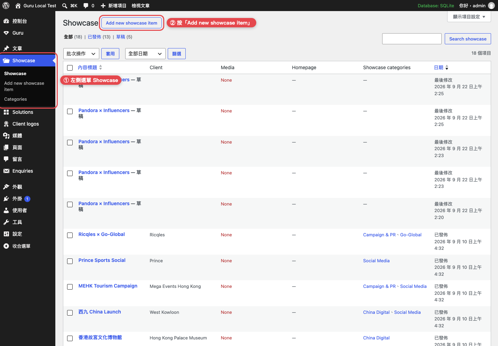
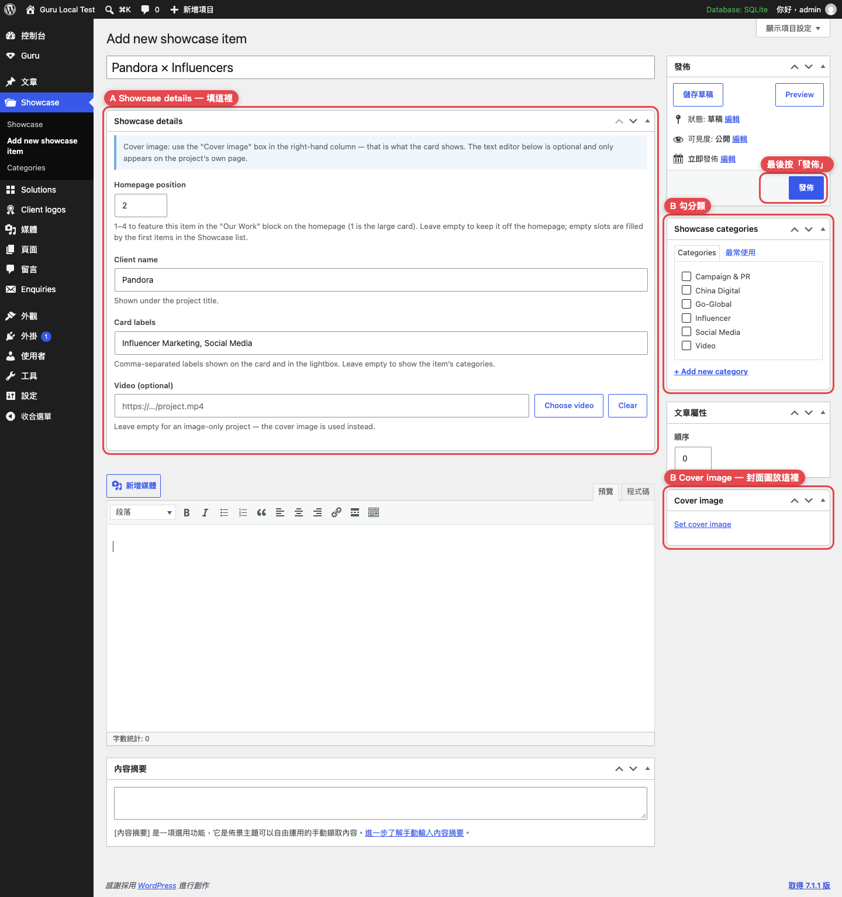
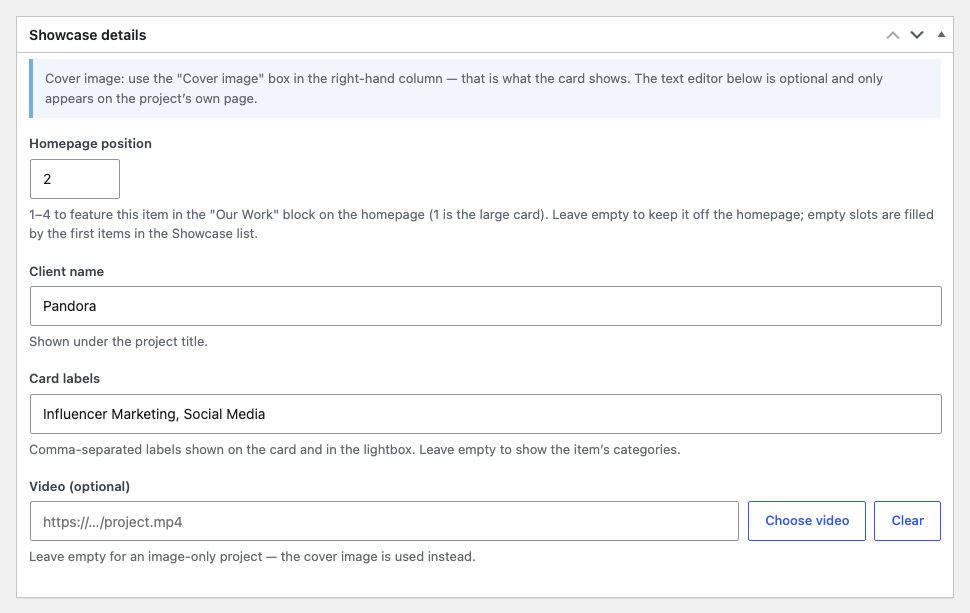
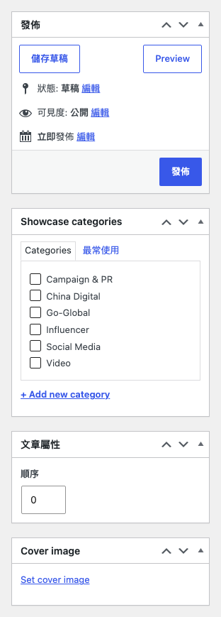
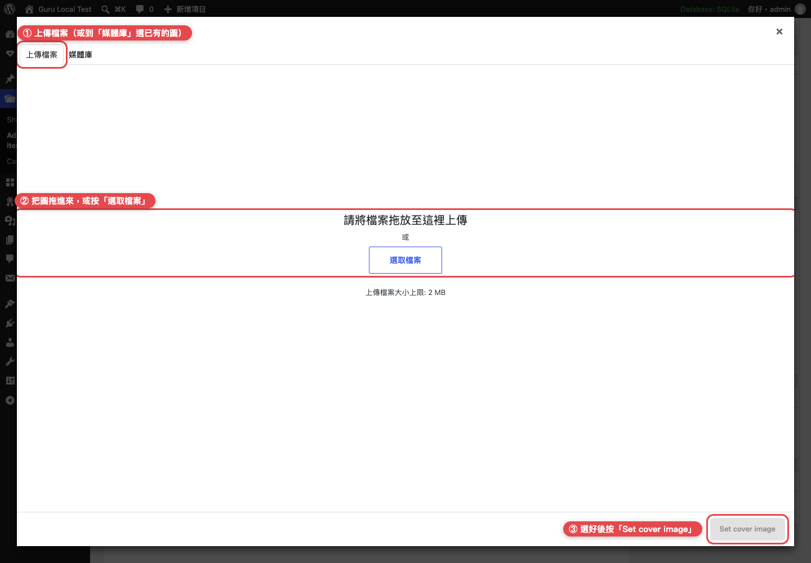
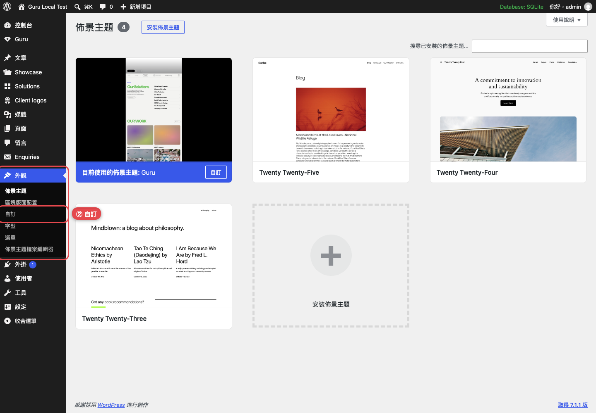
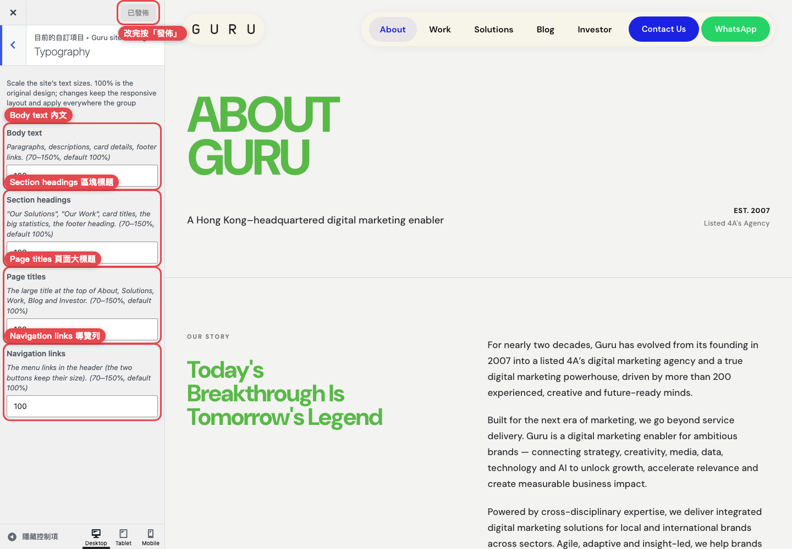

# Guru 網站後台操作指南

適用版本：主題 v1.2.3（2026-09-22）
登入網址：與現在相同（`/wp-admin/`），帳號密碼不變。

本指南兩件事：**上架一個作品（Showcase）**、**調整網站字體大小**。最後附上其他常改項目的位置。
截圖為實際後台畫面，紅框是要點的地方。

---

## 一、上架一個作品（Showcase）

### 事前準備

| 檔案 | 規格 |
|---|---|
| 封面圖 | **JPG**，長邊 **2000px 以內**，檔案 **2 MB 以內**。設計原檔請先縮圖再上傳 |
| 影片（影片作品才需要） | **MP4**，**30 MB 以內**，1080p 以下 |

> 主機處理大檔案的速度有限，太大的圖片會上傳失敗（畫面左下角出現黑色錯誤訊息，檔案沒有存進去）。先縮圖是最有效的解法。

### 步驟 1：Showcase → Add new showcase item

左側選單 **Showcase**，按上方的 **Add new showcase item**。

### 步驟 2：填寫編輯畫面

整個畫面長這樣。**A** 是必填欄位，**B** 是封面圖與分類，最後按右上角**發佈**。中間的內文編輯器是選用的。

**A — Showcase details**（標題正下方）

| 欄位 | 填什麼 |
|---|---|
| Homepage position | 填 **1～4**，作品會出現在首頁「Our Work」四格（1 是大卡）。留空 = 只出現在 Work 頁 |
| Client name | 客戶名稱，顯示在專案名稱下方 |
| Card labels | 卡片上的小標籤，逗號分隔，例如 `Influencer Marketing, Social Media`。留空 = 顯示作品的分類名稱 |
| Video (optional) | 影片作品才填：按 **Choose video** → 上傳或從媒體庫選 MP4。有影片的卡片會自動播放 |

**B — 右欄**：發佈區、分類、順序、封面圖

- **Showcase categories**：勾選分類（Campaign & PR／China Digital／Go-Global／Influencer／Social Media／Video）。Work 頁的篩選按鈕靠這個。
- **文章屬性 → 順序**：數字小的排前面。
- **Cover image → Set cover image**：**封面圖一定要放在這裡**，卡片顯示的就是這張。不要貼進中間的內文編輯器。

### 步驟 3：上傳封面圖

按 **Set cover image** 後會跳出視窗：**① 上傳檔案** 分頁 → **② 把圖拖進來或按「選取檔案」** → 圖片出現在右側並打勾 → **③ 按右下角 Set cover image**。

### 步驟 4：發佈

右上角 **發佈**。前台 **Work** 頁會出現新卡片；有填 Homepage position 的話，首頁「Our Work」也會更新。

### 常見狀況

| 狀況 | 怎麼做 |
|---|---|
| 上傳一直轉圈，或左下角出現黑色錯誤訊息 | 圖片太大。把長邊縮到 2000px、存成 JPG 再試。若還是失敗，把錯誤訊息**整句抄下來**給我們 |
| 修改已上架的作品 | **Showcase** → 點該作品 → 改完按 **更新** |
| 暫時下架 | 右欄「狀態」改成 **草稿** → 更新（隨時可再發佈） |
| 換首頁四格 | 把新作品的 Homepage position 填成想要的數字；原本佔那格的作品改留空 |

---

## 二、調整網站字體大小

### 步驟 1：外觀 → 自訂

### 步驟 2：Guru site settings → Typography

左側點 **Guru site settings** → **Typography**。四個欄位輸入 **70～150** 的數字（預設 100 = 原設計），右側預覽會即時更新；滿意後按最上方 **發佈**。想恢復原設計，改回 100 再發佈。

| 欄位 | 影響範圍 |
|---|---|
| Body text | 內文：段落、說明文字、卡片上的細節、頁尾連結 |
| Section headings | 區塊標題：「Our Solutions」「Our Work」、卡片標題、首頁大數字、頁尾大標題 |
| Page titles | 各頁最上方的大標題（About、Solutions、Work、Blog、Investor） |
| Navigation links | 導覽列的文字連結（兩顆按鈕不變） |

> 建議一次調 5～10%（例如 100 → 110），電腦與手機一起看。標籤、按鈕、表單欄位不會跟著縮放，所以不會把版面撐壞。

---

## 三、其他常改的地方

| 要改什麼 | 在哪裡 |
|---|---|
| 服務項目（Solutions）文字與圖片 | **Solutions** → 點項目編輯；標題下方 **Solution media & highlights** 設定媒體與四張重點卡 |
| 客戶 logo 牆 | **Client logos** → Add new → 右欄設 Logo image（PNG／JPG，正方形約 480px） |
| 首頁跑馬燈 logo | **Client logos** → 編輯某個 logo → 右欄勾 **Show this logo in the homepage marquee** |
| 表單來信 | **Enquiries**（每筆都會存檔並寄到聯絡信箱，可下載 CSV） |
| 電話、WhatsApp、Email | **外觀 → 自訂 → Guru site settings → Contact details** |
| 社群連結 | **外觀 → 自訂 → Guru site settings → Social links** |
| 首頁文字、About 頁文字、投資人頁資料 | **外觀 → 自訂 → Guru site settings** 對應區塊 |
| 導覽列項目 | **外觀 → 選單 → Guru Primary** |
| 網誌文章 | **文章** → 新增（與一般 WordPress 相同） |

有任何畫面跟這份說明不一樣，截圖給我們即可。
